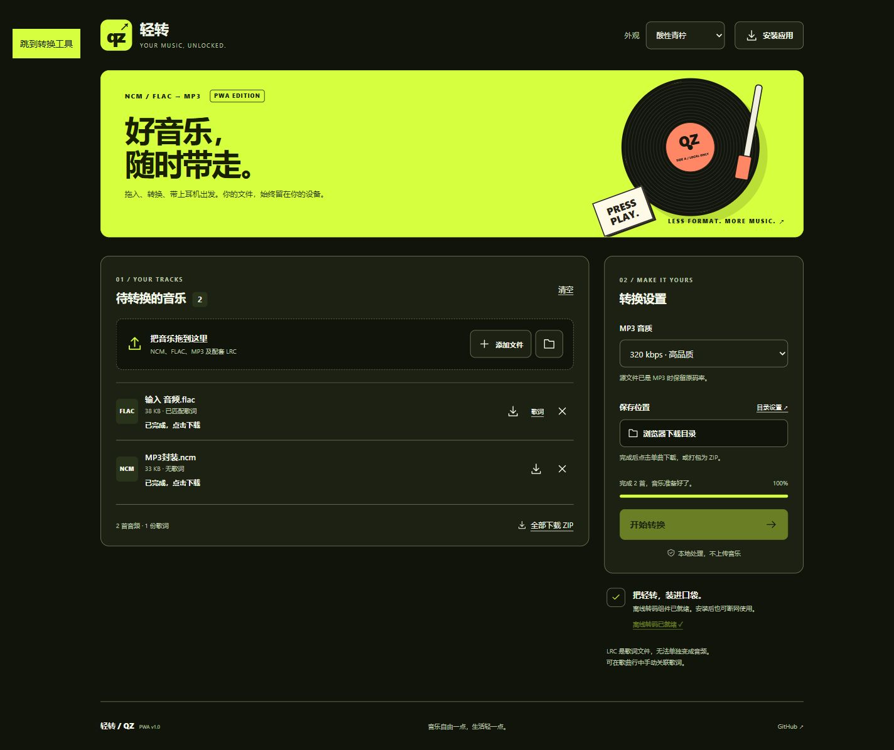
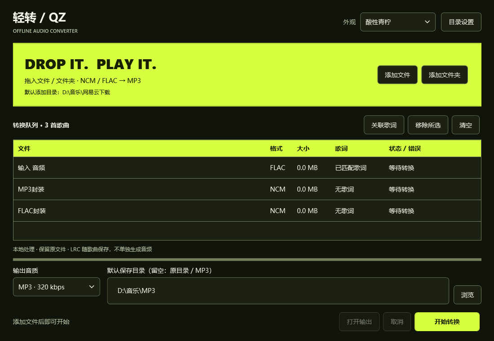
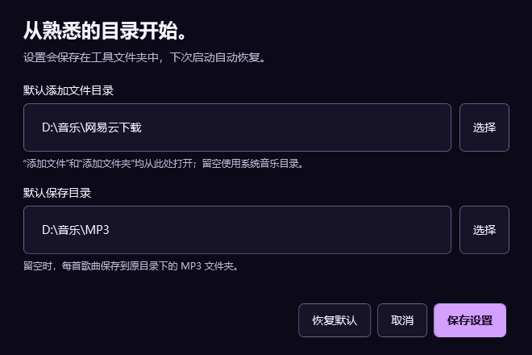
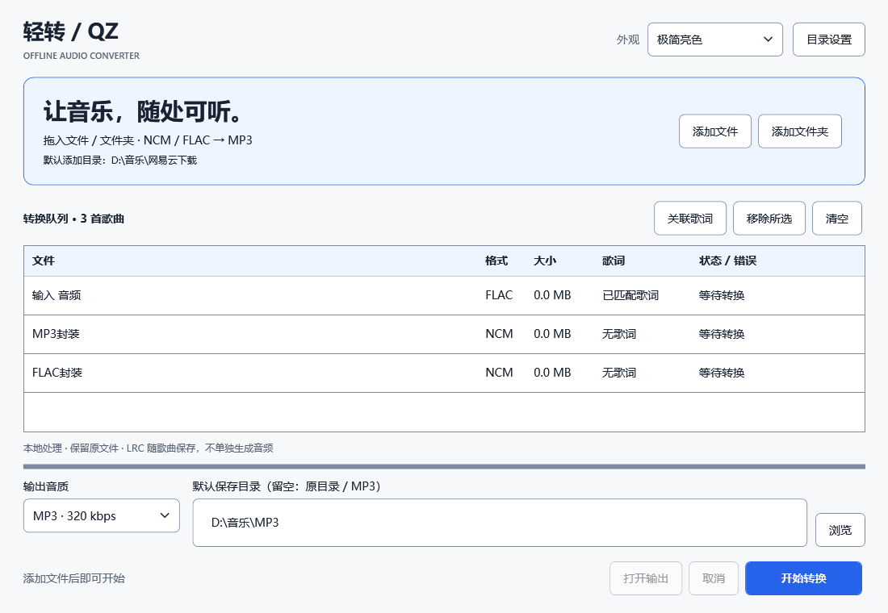
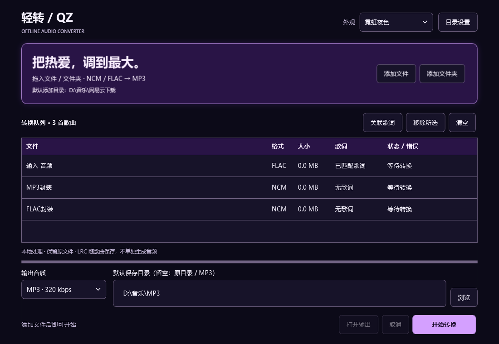
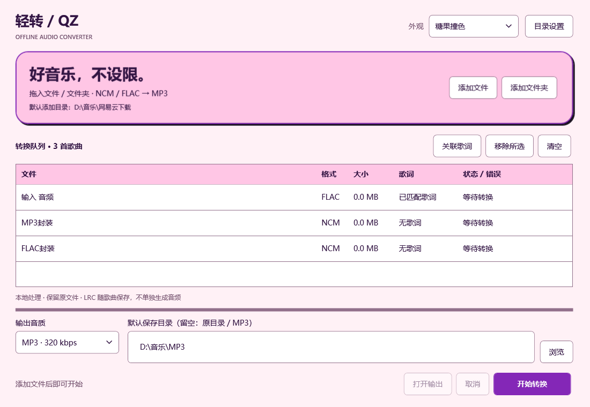

# 轻转 / QingZhuan

## PWA 网页版

[打开轻转 PWA](https://360964487-beep.github.io/Music-Format-Conversion/)

直接在浏览器本地将 NCM、FLAC 转为 MP3，可安装到桌面或手机主屏幕。

- 四套主题、批量队列、歌词自动匹配、单曲下载与 ZIP 打包。
- 点击“准备离线转码”，完成约 31 MB 的组件缓存后，可断网使用。
- 支持的桌面浏览器可记住授权的默认添加目录和保存目录；其他浏览器使用文件选择与下载保存。目录权限可能需要再次确认。
- 单个文件最大 128 MB，每批最多 200 个文件；大文件建议使用 Windows 版。
- 安装入口：页面右上角“安装应用”；iPhone / iPad 可在 Safari 分享菜单中“添加到主屏幕”。未在 iOS 真机验证。
- 队列和转换结果仅在本次页面中保留，刷新前请先下载或保存。



[手机布局预览](docs/pwa-mobile.png) · [PWA 验证记录](docs/PWA-验证结果.md)

PWA 源码位于 `web/`。依赖在构建时下载并校验，不从运行中的第三方 CDN 加载：

```sh
node scripts/prepare-pwa.mjs
node tests/pwa.test.cjs
# 用任意静态服务器提供 web/，例如：
python -m http.server 8080 --directory web
```

GitHub Actions 会在 PWA 代码更新时测试并发布到 GitHub Pages；需要 Pages 的 Source 为 GitHub Actions。


Windows 本地音乐转换工具：将 NCM、FLAC 处理为 MP3，并自动匹配 LRC 歌词。

[下载 Windows 离线版](https://github.com/360964487-beep/Music-Format-Conversion/releases/latest) · [查看发布记录](https://github.com/360964487-beep/Music-Format-Conversion/releases)



## 使用

1. 在 Releases 下载 `QingZhuan-0.2.0-windows-x64.zip`，完整解压。
2. 双击 **轻转.exe**，添加音乐文件或拖入文件夹。
3. 选择音质和保存目录，点击“开始转换”。原文件始终保留。

支持 Windows 10 / 11 64 位，使用系统自带的 .NET Framework 4.x。无需安装 Python、Node.js 或开发环境。主程序很小，离线包主要体积来自 FFmpeg。

## 默认目录

右上角“目录设置”可分别指定默认添加文件目录和默认保存目录。

- 添加文件、添加文件夹会从默认添加目录打开。
- 未设置添加目录时使用系统音乐目录；目录不存在时回退到可用目录。
- 保存目录留空时，输出至每首歌曲原目录下的 `MP3` 文件夹。
- 主窗口中修改保存目录也会记住；主题与音质同样会恢复。
- 设置存放在工具旁的 `settings.json`，不上传到 GitHub。请将工具放在可写目录。



## 四套外观

| 极简亮色 | 霓虹夜色 |
| --- | --- |
|  |  |
| 酸性青柠 | 糖果撞色 |
|  |  |

右上角即时切换，无需重启。界面使用系统字体，主题不需要联网加载资源。

## 文件处理规则

| 输入 | 输出行为 |
| --- | --- |
| NCM | 解析封装；内部 MP3 直接提取，内部 FLAC 转为 MP3 |
| FLAC | 以 128 / 192 / 256 / 320 kbps 转为 MP3 |
| MP3 | 复制音频流，保留原码率，不进行二次压缩 |
| LRC | 与同名歌曲关联，并作为配套歌词保存；不能独立生成音频 |

- 同目录同名歌词优先；跨目录只有唯一同名歌词时自动匹配，也可手动关联。
- 尽量保留标题、歌手、专辑与文件内已有封面，不联网补充缺失封面。
- 输出重名自动编号；失败后可重试未完成项，取消会清理当前未完成文件。
- 本版不提供内嵌歌词写入功能，LRC 保持为独立文件。
- 转换过程在本机执行，不上传音乐文件。

## 从源码构建

在 Windows PowerShell / PowerShell 中，进入仓库目录运行：

```powershell
./src/build.ps1
./scripts/get-ffmpeg.ps1
./scripts/test.ps1
./scripts/package.ps1
```

编译器使用 Windows 的 .NET Framework C# 编译器，不需要额外 SDK。FFmpeg 官方归档下载后会校验 SHA-256。上游下载地址若更新且校验失败，请核验版本后更新 `scripts/dependencies.json`。

GitHub Actions 会在推送 `main` 时执行构建、合成样本测试和打包；`VERSION` 对应的 Release 尚不存在时，会发布该版本。要发布下一版，请修改 `VERSION`。

## 验证范围

测试覆盖 FLAC 转码、NCM 内含 MP3/FLAC、元数据与封面、中文路径、歌词复制、重名保护、取消清理、偏好跨进程恢复，以及真实 WPF 窗口启动与退出。主题图片由实际 XAML 控件渲染。

测试使用生成的音频和 NCM 封装，尚未验证所有网易云真实下载文件及客户端版本；不支持或损坏的文件会显示错误。大量文件夹的导入阶段可能短暂等待。

本仓库同时包含 Windows 桌面版与独立的 PWA 网页版。

## 许可证

应用源码采用 [MIT](LICENSE)。FFmpeg 及其包含的库遵循各自许可证，见 [第三方说明](THIRD_PARTY_NOTICES.md)。
